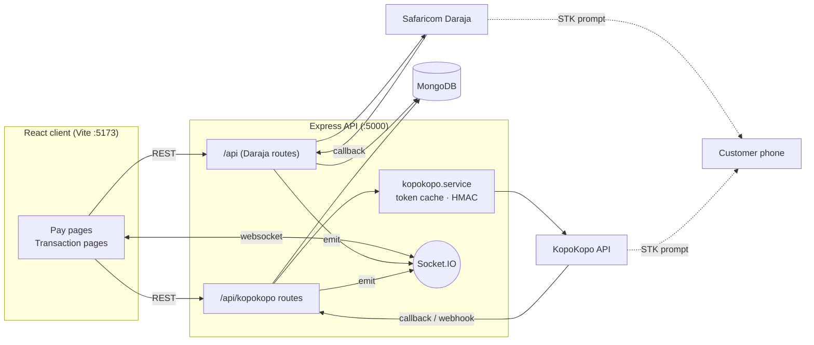
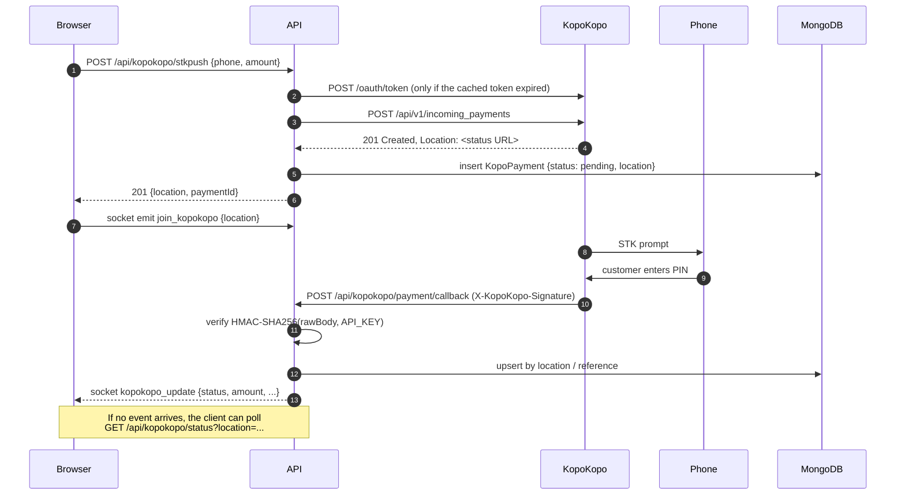
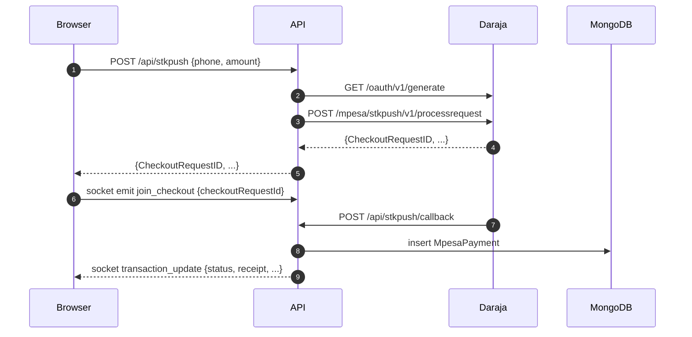

<div align="center">


&nbsp;&nbsp;&nbsp;&nbsp;


# KopoKopo & M-Pesa Payments: End-to-End Integration


Kopokopo

A full-stack reference integration for collecting **M-Pesa STK Push** payments through both **Safaricom Daraja** and **KopoKopo**, with webhook processing, MongoDB persistence, and real-time UI updates over Socket.IO.


</div>

---

## Table of contents

- [Overview](#overview)
- [Architecture](#architecture)
- [Payment flows](#payment-flows)
- [Tech stack](#tech-stack)
- [Project structure](#project-structure)
- [Getting started](#getting-started)
- [Configuration](#configuration)
- [Exposing webhooks locally](#exposing-webhooks-locally)
- [API reference](#api-reference)
- [Real-time events](#real-time-events)
- [Data model](#data-model)
- [Payment status mapping](#payment-status-mapping)
- [Frontend routes](#frontend-routes)
- [Troubleshooting](#troubleshooting)
- [Production readiness](#production-readiness)
- [License](#license)

---

## Overview

The project shows two ways to accept M-Pesa payments in Kenya, side by side:

| | **Safaricom Daraja (direct)** | **KopoKopo (aggregator)** |
|---|---|---|
| Auth | OAuth2 client credentials, a new token per request | OAuth2 client credentials, **cached** in memory until 60s before expiry |
| Initiation | `POST /mpesa/stkpush/v1/processrequest` | `POST /api/v1/incoming_payments` |
| Tracking handle | `CheckoutRequestID` | `Location` header (status URL) |
| Result delivery | Callback to `MPESA_CALLBACK_URL` | Callback to `KOPOKOPO_CALLBACK_URL` + webhook subscriptions |
| Signature verification | None (Daraja doesn't sign callbacks) | HMAC-SHA256 of the raw body, keyed with `KOPOKOPO_API_KEY` |
| Fallback | `GET /stkpush/status/:id` (reads the DB) | `GET /kopokopo/status?location=` (queries KopoKopo live) |

**Key capabilities**

- STK Push initiation through both providers
- Callback and webhook ingestion with KopoKopo signature validation
- Idempotent upsert of KopoKopo payments, keyed by status URL or reference
- Per-transaction Socket.IO rooms, so a browser only gets updates for its own payment
- Transaction history screens with export (PDF/XLSX on the client)
- Light and dark theme

---

## Architecture



---

## Payment flows

### KopoKopo incoming payment



### Safaricom Daraja STK Push



---

## Tech stack

| Layer | Technology |
|---|---|
| **Backend** | Node.js, Express 5, TypeScript, Mongoose 8, Socket.IO 4, Axios, dotenv, ts-node-dev |
| **Frontend** | React 18, TypeScript, Vite 5, Tailwind CSS, Radix UI, React Router 6, Framer Motion, SweetAlert2, socket.io-client |
| **Exports** | jsPDF + jspdf-autotable, SheetJS (`xlsx`) |
| **Storage** | MongoDB (local or Atlas) |

---

## Project structure

```text
.
├── backend/
│   ├── src/
│   │   ├── index.ts                    # Express app, Socket.IO, CORS, Mongo connection
│   │   ├── models/
│   │   │   ├── Payments.ts             # MpesaPayment (Daraja)
│   │   │   └── KopoPayment.ts          # KopoPayment (KopoKopo)
│   │   ├── routes/
│   │   │   ├── mpesa.ts                # /api/stkpush, /api/transactions
│   │   │   └── kopokopo.ts             # /api/kopokopo/*
│   │   └── services/
│   │       └── kopokopo.service.ts     # OAuth token cache, STK, status, webhooks, HMAC
│   ├── tsconfig.json                   # `@/*` path alias → src/*
│   └── package.json
│
└── client/
    ├── src/
    │   ├── App.tsx                     # Route table
    │   ├── pages/
    │   │   ├── homepage.tsx            # Provider picker
    │   │   ├── lipanampesa.tsx         # Daraja payment form
    │   │   ├── kopokopo.tsx            # KopoKopo payment form
    │   │   ├── transaction.tsx         # Daraja history
    │   │   └── kopokopo-transactions.tsx
    │   ├── components/                 # Theme provider/toggle, UI primitives
    │   └── assets/                     # Logos and imagery
    └── package.json
```

---

## Getting started

### Prerequisites

- **Node.js 18+** and npm
- **MongoDB**: a local instance or a MongoDB Atlas connection string
- A **Safaricom Daraja** app ([developer.safaricom.co.ke](https://developer.safaricom.co.ke))
- A **KopoKopo** sandbox application ([developers.kopokopo.com](https://developers.kopokopo.com))
- A tunnelling tool (ngrok, Cloudflare Tunnel, etc.) to receive callbacks

### 1. Clone and install

```bash
git clone <repo-url> kopokopo
cd kopokopo

cd backend && npm install
cd ../client && npm install
```

### 2. Configure environment

Create `backend/.env` and `client/.env` (see [Configuration](#configuration)).

### 3. Run

```bash
# Terminal 1: API on http://localhost:5000
cd backend
npm run dev

# Terminal 2: UI on http://localhost:5173
cd client
npm run dev
```

On startup the backend logs the resolved callback URLs and allowed origins. Check these first when callbacks don't arrive.

### 4. Register KopoKopo webhooks (one-time)

After `KOPOKOPO_WEBHOOK_URL` points at a public URL:

```bash
curl -X POST http://localhost:5000/api/kopokopo/subscribe-webhooks
```

This subscribes the till to `buygoods_transaction_received`, `buygoods_transaction_reversed`, `settlement_transfer_completed` and `customer_created`.

### 5. Production build

```bash
cd backend && npm run build && npm start   # runs dist/index.js with NODE_ENV=production
cd client  && npm run build                 # static output in client/dist
```

---

## Configuration

### `backend/.env`

```env
# --- Server ---------------------------------------------------------------
NODE_ENV=development
PORT=5000
MONGO_URI=mongodb://127.0.0.1:27017/smartpos
# Comma-separated list is supported (e.g. Vite falling back to 5174)
CLIENT_ORIGIN=http://localhost:5173,http://localhost:5174

# --- Safaricom Daraja -----------------------------------------------------
MPESA_BASE_URL=https://sandbox.safaricom.co.ke
MPESA_CONSUMER_KEY=your_consumer_key
MPESA_CONSUMER_SECRET=your_consumer_secret
MPESA_SHORTCODE=174379
MPESA_PASSKEY=your_passkey
TILL_NO=174379                              # PartyB
MPESA_TRANSACTIONTYPE=CustomerPayBillOnline # or CustomerBuyGoodsOnline for tills
MPESA_CALLBACK_URL=https://<public-host>/api/stkpush/callback

# --- KopoKopo -------------------------------------------------------------
KOPOKOPO_BASE_URL=https://sandbox.kopokopo.com
KOPOKOPO_CLIENT_ID=your_client_id
KOPOKOPO_CLIENT_SECRET=your_client_secret
KOPOKOPO_API_KEY=your_api_key               # also the HMAC secret for webhook signatures
KOPOKOPO_TILL_NUMBER=K000000
KOPOKOPO_CALLBACK_URL=https://<public-host>/api/kopokopo/payment/callback
KOPOKOPO_WEBHOOK_URL=https://<public-host>/api/kopokopo/webhooks
```

| Variable | Required | Notes |
|---|:-:|---|
| `MONGO_URI` | ✅ | The server starts without it, but every DB call fails. |
| `CLIENT_ORIGIN` | ✅ | Used by both CORS and the Socket.IO handshake. |
| `MPESA_*`, `TILL_NO` | Daraja only | Sandbox shortcode `174379` uses the public sandbox passkey. |
| `KOPOKOPO_*` | KopoKopo only | `KOPOKOPO_API_KEY` must match the key KopoKopo signs callbacks with. |
| `*_CALLBACK_URL`, `*_WEBHOOK_URL` | ✅ | Must be **public HTTPS** URLs. `localhost` won't work. |

### `client/.env`

```env
VITE_API_URL=http://localhost:5000/api
VITE_SOCKET_URL=http://localhost:5000
```

If `VITE_SOCKET_URL` is omitted, the Daraja page uses `VITE_API_URL` with the trailing `/api` removed.

> **Never commit `.env` files.** Both are already in `.gitignore`. Rotate any credentials that have been pushed.

---

## Exposing webhooks locally

Safaricom and KopoKopo must be able to reach your machine:

```bash
ngrok http 5000
```

Copy the HTTPS forwarding URL into `MPESA_CALLBACK_URL`, `KOPOKOPO_CALLBACK_URL` and `KOPOKOPO_WEBHOOK_URL`. Restart the backend, then re-run `subscribe-webhooks`. Free ngrok URLs change on every restart, so you'll need to update these each time.

---

## API reference

Base URL: `http://localhost:5000`

### Safaricom Daraja

| Method | Path | Body / Params | Description |
|---|---|---|---|
| `POST` | `/api/stkpush` | `{ phone, amount }` | Starts an STK Push. Accepts `07…`, `254…` or `+254…`. Returns Daraja's response, including `CheckoutRequestID`. |
| `POST` | `/api/stkpush/callback` | Daraja payload | Saves the result (success or failure) and emits `transaction_update`. |
| `GET` | `/api/stkpush/status/:checkoutRequestId` | | Returns the stored status. Returns `404 {status: "pending"}` until the callback arrives. |
| `GET` | `/api/transactions` | | Latest 50 Daraja transactions. |

### KopoKopo

| Method | Path | Body / Params | Description |
|---|---|---|---|
| `POST` | `/api/kopokopo/stkpush` | `{ phone, amount, description? }` | Creates an incoming payment and saves a `pending` record. Returns `201 { location, paymentId }`. |
| `GET` | `/api/kopokopo/status` | `?location=<url>` | Asks KopoKopo for the current status of the payment. |
| `POST` | `/api/kopokopo/payment/callback` | KopoKopo payload | Checks the signature, upserts the payment and emits `kopokopo_update`. |
| `POST` | `/api/kopokopo/webhooks` | KopoKopo event | Generic event handler. Emits `kopokopo_webhook`. Upserts on `buygoods_transaction_received` / `b2b_transaction_received`. |
| `POST` | `/api/kopokopo/subscribe-webhooks` | | Registers the till's webhook subscriptions (one-time setup). |
| `GET` | `/api/kopokopo/transactions` | | Latest 50 KopoKopo transactions. |

<details>
<summary><strong>Example: start a KopoKopo payment</strong></summary>

```bash
curl -X POST http://localhost:5000/api/kopokopo/stkpush \
  -H "Content-Type: application/json" \
  -d '{"phone":"0712345678","amount":10,"description":"Order #1001"}'
```

```json
{
  "location": "https://sandbox.kopokopo.com/api/v1/incoming_payments/247b1bd8-f5a0-4b71-a898-f62f67b8ae1c",
  "paymentId": "6650c1f2a9e1b2c3d4e5f678"
}
```

</details>

<details>
<summary><strong>Example: start a Daraja STK Push</strong></summary>

```bash
curl -X POST http://localhost:5000/api/stkpush \
  -H "Content-Type: application/json" \
  -d '{"phone":"254712345678","amount":1}'
```

```json
{
  "MerchantRequestID": "29115-34620561-1",
  "CheckoutRequestID": "ws_CO_191220191020363925",
  "ResponseCode": "0",
  "ResponseDescription": "Success. Request accepted for processing",
  "CustomerMessage": "Success. Request accepted for processing"
}
```

</details>

---

## Real-time events

Clients connect to `VITE_SOCKET_URL` and join a room for the payment they started.

| Direction | Event | Payload | Purpose |
|---|---|---|---|
| client → server | `join_checkout` | `{ checkoutRequestId }` | Subscribe to one Daraja transaction |
| client → server | `join_kopokopo` | `{ location }` | Subscribe to one KopoKopo payment |
| server → room | `transaction_update` | `{ checkoutRequestId, status, resultCode, resultDesc, amount, receipt, phone }` | Daraja result |
| server → room **and** all clients | `kopokopo_update` | `{ paymentId, reference, status, amount, currency, phone, transactionReference, originationTime }` | KopoKopo result |
| server → all clients | `kopokopo_webhook` | `{ eventType, payload }` | Raw webhook event (for dashboards/debugging) |

```ts
import { io } from 'socket.io-client';

const socket = io(import.meta.env.VITE_SOCKET_URL);
socket.emit('join_kopokopo', { location });
socket.on('kopokopo_update', (e) => {
  if (e.status === 'success') showReceipt(e.transactionReference);
});
```

---

## Data model

**`KopoPayment`** (collection `kopopayments`)

| Field | Type | Notes |
|---|---|---|
| `location` | string | KopoKopo status URL. Used as the upsert key. |
| `reference` | string (indexed) | KopoKopo resource id |
| `status` | string | `pending` · `success` · `failed` · `reversed` |
| `eventType` | string | Defaults to `buygoods_transaction_received` |
| `amount`, `currency` | number, string | Currency defaults to `KES` |
| `phone`, `tillNumber`, `description` | string | |
| `transactionReference` | string | M-Pesa receipt number |
| `originationTime` | string | From KopoKopo |
| `rawPayload` | object | Full callback body, kept for auditing |
| `createdAt`, `updatedAt` | Date | Set automatically by Mongoose |

**`MpesaPayment`** (collection `mpesapayments`)

`MerchantRequestID`, `CheckoutRequestID`, `ResultCode`, `ResultDesc`, `Amount`, `MpesaReceiptNumber`, `TransactionDate`, `PhoneNumber`, plus timestamps.

---

## Payment status mapping

**KopoKopo → internal**

| KopoKopo status | Internal |
|---|---|
| `Received`, `Success`, `Complete` | `success` |
| `Failed`, `Error` | `failed` |
| `Reversed` | `reversed` |
| `Pending` / anything else | `pending` |

**Daraja `ResultCode` / `ResultDesc` → internal**

| Condition | Internal |
|---|---|
| `0` | `success` |
| `1032` or "cancel" | `cancelled` |
| `1037` or "timeout" | `timeout` |
| "pin" | `wrong_pin` |
| "insufficient" / "less than" | `insufficient_funds` |
| anything else | `failure` |

---

## Frontend routes

| Path | Page |
|---|---|
| `/` | Choose a provider |
| `/pay/mpesa` | Pay through Daraja |
| `/pay/kopokopo` | Pay through KopoKopo |
| `/transactions` | Daraja transaction history |
| `/transactions/kopokopo` | KopoKopo transaction history |

---

## Troubleshooting

| Symptom | Likely cause |
|---|---|
| STK prompt arrives, but the UI never updates | Callback URL isn't publicly reachable, or the ngrok URL changed. Check the backend logs for incoming callback lines. |
| `401 Invalid signature` on KopoKopo callbacks | `KOPOKOPO_API_KEY` doesn't match the app that sent the request, or a proxy changed the body before it reached Express. |
| `Kopokopo did not return a payment location URL` | Wrong `KOPOKOPO_TILL_NUMBER` or base URL (sandbox vs production). |
| Daraja `Invalid Timestamp` / password errors | The server clock isn't on Kenyan time (EAT, UTC+3). The timestamp uses the server's local timezone. |
| CORS or socket handshake errors | The client origin is missing from `CLIENT_ORIGIN`. |
| History pages are empty | MongoDB isn't connected. Look for `MongoDB connected.` at startup. |

---

## Production readiness

This is a **development/reference** integration. Fix the following before it handles real money:

- **Enforce webhook signatures.** Callbacks are currently verified only *when* the `X-KopoKopo-Signature` header is present. Reject unsigned requests. Also check signature length before `crypto.timingSafeEqual`, because it throws when the buffers differ in length.
- **Restrict `/kopokopo/status`.** It forwards an arbitrary client-supplied URL together with the KopoKopo bearer token. Allow only URLs under `KOPOKOPO_BASE_URL`, or look the URL up by `paymentId` from the database.
- **Stop broadcasting payment data.** `kopokopo_update` and `kopokopo_webhook` are sent to *every* connected socket, which exposes phone numbers and amounts. Emit to the payment's room only.
- **Authenticate the API.** No route requires authentication, including `subscribe-webhooks` and the transaction listings.
- **Validate input.** Check phone format and amount bounds (for example with zod), and rate-limit `stkpush` to prevent prompt spam.
- **Make Daraja callbacks idempotent.** Use an upsert on `CheckoutRequestID` instead of an insert, so retried callbacks don't create duplicate rows.
- **Fix the timezone.** Generate the Daraja timestamp in `Africa/Nairobi` explicitly instead of the server's local time.
- **Fail fast on config.** Validate required env vars at boot, and exit if MongoDB can't connect.
- **Observability.** Replace `console.log` with structured logging (pino), redact PII, and add health and readiness endpoints.
- **Missing endpoint.** The Daraja history page calls `POST /api/b2c`, which has no backend implementation.

---

## License

ISC, as declared in [backend/package.json](backend/package.json).
